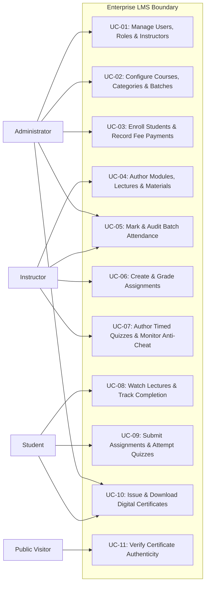

# Use Case Specifications & Three-Role Permission Matrix

**Document Version:** 1.0.0  
**Project:** Enterprise LMS  

---

## 1. Actor Definitions

1. **Administrator (`ADMIN`):** Superuser managing institutional setup, staff/student onboarding, course & batch governance, fee collection, certificate issuance, and system auditing.
2. **Instructor (`INSTRUCTOR`):** Academic facilitator responsible for curriculum delivery, lectures, study materials, daily attendance, assignment grading, and quiz management for assigned batches.
3. **Student (`STUDENT`):** Enrolled learner accessing course content, tracking progress, submitting coursework, taking timed quizzes, viewing attendance/fees, and downloading earned certificates.
4. **Public User (`PUBLIC`):** Unauthenticated visitor browsing published courses or verifying a student's certificate authenticity via QR code / Certificate ID.

---

## 2. System Use Case Diagram (Mermaid)

---

## 3. Detailed Actor-Goal Use Cases

### 3.1 Administrator Use Cases

#### UC-ADM-01: Onboard Course, Create Batch & Assign Instructor
- **Primary Actor:** Administrator
- **Preconditions:** Admin is authenticated; at least one active Course Category and one active Instructor exist.
- **Main Success Scenario:**
  1. Admin creates a Course (`POST /api/v1/courses`) with code, fee, level, and modules.
  2. Admin creates a Batch (`POST /api/v1/batches`) linked to the Course and assigns an active `instructor_id`.
  3. Admin defines `start_date`, `end_date`, `max_capacity`, and schedule slot.
  4. System validates dates (`end_date >= start_date`) and capacity (`max_capacity > 0`), persists the batch, and notifies the assigned Instructor.
- **Postconditions:** Batch is live in `UPCOMING` or `ONGOING` status and ready for student enrollment.

#### UC-ADM-02: Enroll Student & Process Installment Payment
- **Primary Actor:** Administrator
- **Preconditions:** Student account is active; target Batch has available capacity (`current_strength < max_capacity`).
- **Main Success Scenario:**
  1. Admin submits enrollment (`POST /api/v1/enrollments`) linking `student_id`, `course_id`, and `batch_id`.
  2. System checks duplicate enrollment constraint and increments `batches.current_strength`.
  3. System initializes fee record with `total_fee`, `discount_amount`, `paid_amount = 0`, and `pending_amount = net_fee`.
  4. Admin records an installment payment (`POST /api/v1/payments`).
  5. System updates `paid_amount`, recalculates `pending_amount = total_fee - discount - paid_amount`, generates a `payment_receipts` entry, and sends an in-app notification to the Student.
- **Exceptions:**
  - *E1: Batch Full* — System rejects enrollment with HTTP `409 Conflict` (`BATCH_CAPACITY_EXCEEDED`).
  - *E2: Overpayment* — System rejects payment exceeding `pending_amount` with HTTP `422 Unprocessable Entity`.

#### UC-ADM-03: Approve & Issue Course Completion Certificate
- **Primary Actor:** Administrator (or Automated Eligibility Trigger)
- **Preconditions:** Student enrollment is active; course completion >= 80%; attendance >= 75%; pending fee == 0.
- **Main Success Scenario:**
  1. Admin triggers certificate generation (`POST /api/v1/certificates/issue`).
  2. System evaluates the Business Policy Eligibility Engine (Completion, Attendance, Assessments, Fee clearance).
  3. System generates a unique `certificate_code` (e.g., `CERT-2026-LMS-00042`) and `verification_uuid`.
  4. System renders the PDF certificate, stores the metadata in `certificates`, logs an audit entry, and notifies the Student.

---

### 3.2 Instructor Use Cases

#### UC-INS-01: Publish Lectures & Study Materials
- **Primary Actor:** Instructor
- **Preconditions:** Instructor is authenticated and assigned to the target course/batch.
- **Main Success Scenario:**
  1. Instructor selects an assigned Course Module and adds a new Lecture (`POST /api/v1/lectures`) with video URL, duration, and order index.
  2. Instructor uploads supplementary PDF/slides (`POST /api/v1/materials`).
  3. System validates file MIME type and size, stores the file, and notifies enrolled batch students.

#### UC-INS-02: Mark Daily Batch Attendance
- **Primary Actor:** Instructor
- **Preconditions:** Batch status is `ONGOING`; session date is within batch schedule.
- **Main Success Scenario:**
  1. Instructor opens the Batch Attendance sheet for a specific `attendance_date`.
  2. Instructor marks each enrolled student as `PRESENT`, `ABSENT`, `LATE`, or `EXCUSED` (or marks the entire day as `HOLIDAY` / `CANCELLED`).
  3. System upserts records into `attendance` (`UNIQUE(batch_id, student_id, attendance_date)`).
  4. System recalculates each student's cumulative attendance percentage and alerts students dropping below the 75% threshold.

#### UC-INS-03: Grade Student Assignment Submission
- **Primary Actor:** Instructor
- **Preconditions:** Student has submitted an assignment (`submissions.status = 'SUBMITTED'`).
- **Main Success Scenario:**
  1. Instructor reviews the student's uploaded submission file and submission timestamp.
  2. Instructor enters `marks_obtained` (0 to `max_marks`) and structured feedback (`POST /api/v1/submissions/{id}/grade`).
  3. If submitted late and a late penalty applies, system displays/applies the configured penalty deduction.
  4. System saves `assignment_feedback`, updates submission status to `GRADED`, recalculates the student's course completion score, and notifies the student.

---

### 3.3 Student Use Cases

#### UC-STU-01: Watch Lecture & Auto-Sync Course Progress
- **Primary Actor:** Student
- **Preconditions:** Student has an `ACTIVE` enrollment in the course/batch.
- **Main Success Scenario:**
  1. Student opens the course player and streams a lecture.
  2. Frontend periodically sends heartbeat progress (`POST /api/v1/progress/lectures/{lecture_id}`) with `watch_time_seconds`.
  3. Once watch progress reaches >= 90% or student clicks "Mark Complete", system sets `is_completed = True`.
  4. System recalculates overall weighted course completion (`50% Lectures + 30% Assignments + 20% Quizzes`) and updates `enrollments.completion_percentage`.

#### UC-STU-02: Attempt Timed Quiz with Server-Side Enforcement
- **Primary Actor:** Student
- **Preconditions:** Quiz is published; current time is within quiz availability window; student attempts `< max_attempts`.
- **Main Success Scenario:**
  1. Student starts quiz attempt (`POST /api/v1/quizzes/{id}/start`).
  2. Server creates `quiz_attempts` row with `started_at = NOW()` and `expires_at = NOW() + time_limit_minutes`.
  3. Student answers questions; client logs any focus/tab-switch events to `POST /api/v1/quizzes/attempts/{attempt_id}/events`.
  4. Student submits answers (`POST /api/v1/quizzes/attempts/{attempt_id}/submit`) before `expires_at` (plus 30-second network grace window).
  5. Server validates timestamps, grades all objective questions against `quiz_options.is_correct`, computes percentage and pass/fail status, and updates course completion.

---

### 3.4 Public Verification Use Case

#### UC-PUB-01: Verify Digital Certificate Authenticity
- **Primary Actor:** Public Visitor / Employer
- **Preconditions:** Visitor possesses a Certificate Code or scans the QR code on a certificate PDF.
- **Main Success Scenario:**
  1. Visitor navigates to `/verify/{certificate_code}` or queries `GET /api/v1/certificates/verify/{certificate_code}`.
  2. System looks up the certificate in `certificates` joined with `users` (student name) and `courses` (course title).
  3. If valid and `status = 'ISSUED'`, system returns verification badge, masked student identifier, course title, issue date, and grade.
  4. If `status = 'REVOKED'`, system explicitly warns that the certificate was revoked along with revocation date.

---

## 4. Three-Role Permission Matrix (RBAC + Ownership)

Legend:
- **FULL:** Create, Read, Update, Delete / Execute across all records
- **SCOPED:** Allowed only for courses/batches assigned to the Instructor
- **OWN:** Allowed only for the authenticated user's own records
- **READ:** Read-only access (published/enrolled scope)
- **NONE:** Access denied (`403 Forbidden`)

| Module / Resource | Action | `ADMIN` | `INSTRUCTOR` | `STUDENT` | `PUBLIC` |
| :--- | :--- | :---: | :---: | :---: | :---: |
| **Auth (`/auth`)** | Login / Refresh / Forgot Password | FULL | FULL | FULL | FULL |
| **Users (`/users`)** | List / Create / Change Role / Deactivate | FULL | NONE | NONE | NONE |
| **Users (`/users/me`)** | View & Update Own Profile | OWN | OWN | OWN | NONE |
| **Instructors (`/instructors`)** | Create / Assign / View Directory | FULL | OWN (Read/Bio) | READ | READ |
| **Categories (`/categories`)** | Create / Edit / Archive Categories | FULL | READ | READ | READ |
| **Courses (`/courses`)** | Create / Edit / Publish / Delete Course | FULL | SCOPED (Edit Content) | READ (Enrolled/Public) | READ (Published) |
| **Modules (`/courses/{id}/modules`)** | Add / Reorder / Update Modules | FULL | SCOPED | READ (Enrolled) | READ (Syllabus) |
| **Batches (`/batches`)** | Create Batch / Assign Instructor / Capacity | FULL | SCOPED (Read Roster) | READ (Own Batch) | NONE |
| **Enrollments (`/enrollments`)** | Enroll Student / Change Status | FULL | SCOPED (Read Only) | OWN (Read Only) | NONE |
| **Lectures (`/lectures`)** | Create / Update / Reorder Lectures | FULL | SCOPED | READ (Enrolled) | READ (Free Preview) |
| **Materials (`/materials`)** | Upload / Delete Study Material | FULL | SCOPED | READ/DOWNLOAD (Enrolled) | NONE |
| **Progress (`/progress`)** | Mark Lecture Complete / View Progress | FULL (Read All) | SCOPED (Read Batch) | OWN (Write/Read) | NONE |
| **Assignments (`/assignments`)** | Create / Update / Delete Assignment | FULL | SCOPED | READ (Enrolled) | NONE |
| **Submissions (`/submissions`)** | Upload Assignment Submission | READ | SCOPED (Read) | OWN (Create/Read) | NONE |
| **Grading (`/submissions/{id}/grade`)**| Grade & Provide Rubric Feedback | FULL | SCOPED | OWN (Read Feedback) | NONE |
| **Quizzes (`/quizzes`)** | Author Quiz & Question Bank | FULL | SCOPED | READ Metadata (Enrolled) | NONE |
| **Quiz Attempts (`/quizzes/{id}/start`)**| Take Quiz & Submit Answers | FULL (Read/Audit) | SCOPED (Read/Grade) | OWN (Attempt/View) | NONE |
| **Attendance (`/attendance`)** | Mark / Update Batch Attendance | FULL | SCOPED (Mark/Read) | OWN (Read Summary) | NONE |
| **Certificates (`/certificates`)** | Issue / Revoke / Download Certificate | FULL | SCOPED (Read) | OWN (Read/Download) | READ (Verify by Code) |
| **Payments (`/payments`)** | Record Payment / Issue Receipt | FULL | NONE | OWN (Read Ledger/Receipt) | NONE |
| **Notifications (`/notifications`)** | Read / Mark Notifications Read | OWN | OWN | OWN | NONE |
| **Announcements (`/announcements`)** | Publish Global / Batch Announcements | FULL (All Scopes) | SCOPED (Batch/Course) | READ (Targeted) | NONE |
| **Reports (`/reports`)** | View Analytics & Export CSV/PDF | FULL | SCOPED | OWN (Academic Summary) | NONE |
| **System Settings & Audit Logs** | Modify Settings / Inspect Audit Trail | FULL | NONE | NONE | NONE |
