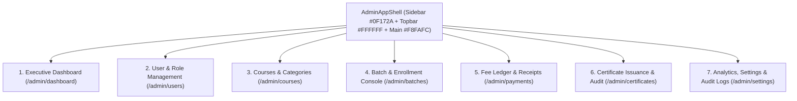

# Admin Portal UI/UX Wireframes & Component Hierarchy

**Document Version:** 1.0.0  
**Target Role:** Administrator (`ADMIN`)  
**Design System Palette:**
- **Primary Brand (Indigo 600):** `#4F46E5`
- **Secondary Accent (Cyan 500):** `#06B6D4`
- **Highlight / AI / Analytics (Violet 500):** `#8B5CF6`
- **Surface Background (Slate 50):** `#F8FAFC`
- **Dark Surface / Sidebar (Slate 900):** `#0F172A`

---

## 1. Layout Hierarchy & Navigation Flow



---

## 2. Screen 1: Admin Executive Dashboard (`/admin/dashboard`)

```
+--------------------------------------------------------------------------------------------------+
| [LMS LOGO #4F46E5]   Enterprise LMS Admin        [Search Ctrl+K...]   [Bell(4)] [Admin Avatar v] |
+----------------------+---------------------------------------------------------------------------+
| NAVIGATION (#0F172A) | MAIN WORKSPACE (#F8FAFC)                                                  |
|                      |                                                                           |
| (*) Dashboard        | Welcome back, System Administrator          [+ Quick Enroll] [+ New Course]|
| ( ) Users & Roles    |                                                                           |
| ( ) Instructors      | +-----------------+ +-----------------+ +-----------------+ +------------+|
| ( ) Categories       | | TOTAL STUDENTS  | | ACTIVE BATCHES  | | REVENUE (MTD)   | | PENDING FEE||
| ( ) Courses          | | 1,420 (+12.4%)  | | 28 (91% Occup.) | | $84,500 (#4F46E5)| | $11,200    ||
| ( ) Batches          | +-----------------+ +-----------------+ +-----------------+ +------------+|
| ( ) Enrollments      |                                                                           |
| ( ) Attendance Audit | +-----------------------------------------------+ +----------------------+|
| ( ) Payments & Fees  | | ENROLLMENT & REVENUE TREND (12 Months)        | | BATCH CAPACITY HEALTH||
| ( ) Certificates     | |   ^                                           | | Full-Stack B1 [95%]  ||
| ( ) Announcements    | |   |        .--.      .--.      .--* (#4F46E5) | | Data Sci B4   [88%]  ||
| ( ) Reports & Export | |   |   .--'      '--'      '--'                | | Cloud Ops B2  [72%]  ||
| ( ) Audit Logs       | |   +-----------------------------------------> | | UI/UX Cohort  [60%]  ||
| ( ) System Settings  | +-----------------------------------------------+ +----------------------+|
|                      |                                                                           |
|                      | +-----------------------------------------------------------------------+ |
|                      | | RECENT AUDIT LOGS & CRITICAL EVENTS                    [View All ->]  | |
|                      | | Time     | Actor          | Action             | Target     | Status  | |
|                      | | 10:14 AM | admin@lms.edu  | CERTIFICATE_ISSUED | CERT-0042  | SUCCESS | |
|                      | | 09:50 AM | admin@lms.edu  | PAYMENT_RECORDED   | RCPT-9921  | $450.00 | |
|                      | | 09:12 AM | inst1@lms.edu  | ATTENDANCE_MARKED  | BATCH-FS01 | 28/30   | |
|                      | +-----------------------------------------------------------------------+ |
+----------------------+---------------------------------------------------------------------------+
```

---

## 3. Screen 2: User, Batch & Enrollment Management (`/admin/batches`)

```
+--------------------------------------------------------------------------------------------------+
| BATCH & COHORT MANAGEMENT                                          [+ Create Batch (#4F46E5)]    |
+--------------------------------------------------------------------------------------------------+
| Filters: [Course: All v] [Instructor: All v] [Status: ONGOING v] [Search Batch Code...]          |
+--------------------------------------------------------------------------------------------------+
| Batch Code | Course Title          | Instructor     | Schedule         | Capacity  | Status | Act|
|------------|-----------------------|----------------|------------------|-----------|--------|----|
| FSWD-2026A | Full-Stack Web Dev    | Dr. A. Sharma  | Mon-Wed-Fri 10AM | 28 / 30   | ONGOING| [v]|
| DSML-2026B | Data Science & ML     | Prof. R. Chen  | Tue-Thu 02:00PM  | 25 / 25   | FULL   | [v]|
| CYBR-2026C | Cybersecurity Ops     | Ms. K. Patel   | Sat-Sun 11:00AM  | 14 / 20   | UPCOMNG| [v]|
+--------------------------------------------------------------------------------------------------+
| SELECTED BATCH DRAWER: FSWD-2026A (Capacity Bar: [██████████████████░░] 93.3%)                   |
| Tabs: [Enrolled Students (28)] [Attendance Register] [Fee Defaulters (3)] [Announcements]        |
| +----------------------------------------------------------------------------------------------+ |
| | Student ID | Name           | Attendance % | Completion % | Fee Status        | Actions      | |
| | STU-1001   | Aarav Mehta    | 92.5% (Good) | 84.0%        | PAID ($1,200)     | [Issue Cert] | |
| | STU-1004   | Priya Nair     | 71.0% (Warn) | 68.5%        | PARTIAL ($400 Due)| [+ Payment]  | |
| +----------------------------------------------------------------------------------------------+ |
+--------------------------------------------------------------------------------------------------+
```

---

## 4. Screen 3: Fee Collection & Receipt Generation Modal (`/admin/payments`)

```
+-----------------------------------------------------------------------+
| RECORD FEE INSTALLMENT PAYMENT                                    [X] |
+-----------------------------------------------------------------------+
| Student: Priya Nair (STU-1004)     Batch: FSWD-2026A                  |
|-----------------------------------------------------------------------|
| Total Course Fee : $1,200.00       Discount Applied : $100.00         |
| Net Payable Fee  : $1,100.00       Already Paid     : $700.00         |
| CURRENT PENDING  : $400.00 (Highlighted in Amber #F59E0B)             |
|-----------------------------------------------------------------------|
| Payment Amount * : [ 400.00                  ] (Max: $400.00)         |
| Payment Method * : [ UPI / Online Transfer v ]                        |
| Transaction Ref  : [ UTR99283746512          ]                        |
| Payment Date *   : [ 2026-11-25              ]                        |
| Remarks          : [ Final installment cleared               ]        |
|                                                                       |
| [x] Auto-generate PDF Payment Receipt & Notify Student                |
|                                                                       |
|                                  [Cancel]  [Confirm & Issue Receipt]  |
+-----------------------------------------------------------------------+
```

---

## 5. Component Breakdown & Tailwind CSS 4 Tokens

| Component Name | File / Module | Tailwind / Styling Specification |
| :--- | :--- | :--- |
| `AdminSidebar` | `components/layout/AdminSidebar.tsx` | `bg-slate-900 text-slate-100 w-64 shrink-0`, active link pill `bg-indigo-600 text-white shadow-sm` |
| `KpiStatCard` | `components/dashboard/KpiStatCard.tsx` | `bg-white rounded-xl border border-slate-200 p-5 shadow-xs`, icon badge `bg-indigo-50 text-indigo-600` |
| `CapacityProgressBar` | `components/batches/CapacityProgressBar.tsx` | `< 80%` Cyan `#06B6D4`, `80-99%` Violet `#8B5CF6`, `100%` Rose `#F43F5E` |
| `FeeLedgerModal` | `components/payments/FeeLedgerModal.tsx` | Real-time invariant validator enforcing `Paid + Input <= Total - Discount` |
| `AuditLogDiffViewer` | `components/settings/AuditLogDiffViewer.tsx` | Side-by-side JSON diff viewer highlighting `old_values` vs `new_values` |
