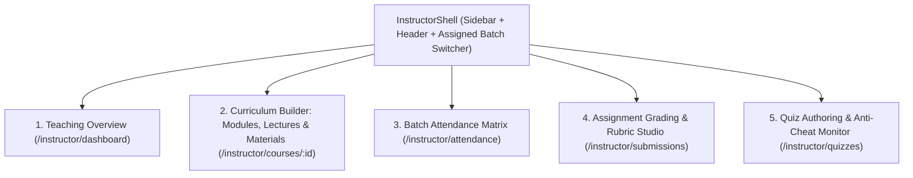

# Instructor Portal UI/UX Wireframes & Component Hierarchy

**Document Version:** 1.0.0  
**Target Role:** Instructor (`INSTRUCTOR`)  
**Design System Palette:** `#4F46E5` (Primary Indigo), `#06B6D4` (Secondary Cyan), `#8B5CF6` (Accent Violet), `#F8FAFC` (Background Slate 50)

---

## 1. Instructor Navigation Architecture



---

## 2. Screen 1: Instructor Workspace & Curriculum Builder (`/instructor/courses/:id`)

```
+--------------------------------------------------------------------------------------------------+
| [LMS] Instructor Studio        Active Batch: [FSWD-2026A v]         [+ Announcement] [Dr. Sharma]|
+----------------------+---------------------------------------------------------------------------+
| NAVIGATION           | CURRICULUM & CONTENT BUILDER — Full-Stack Web Development                 |
|                      |                                                                           |
| ( ) My Dashboard     | +-----------------------------------------------------------------------+ |
| (*) My Courses       | | MODULE 1: Modern React 19 & TypeScript Architecture   [+ Add Lecture] | |
| ( ) My Batches       | |-----------------------------------------------------------------------| |
| ( ) Mark Attendance  | | :: 1.1 Introduction to React 19 Compiler   [Video 24m] [Preview] [Ed] | |
| ( ) Assignments      | |    +-- Materials: [PDF: React19_Slides.pdf (2.4MB)] [+ Attach File]   | |
| ( ) Grading Queue(7) | | :: 1.2 Server Actions & Suspense Patterns  [Video 38m] [Locked]  [Ed] | |
| ( ) Quizzes & Banks  | +-----------------------------------------------------------------------+ |
| ( ) Student Progress |                                                                           |
| ( ) Announcements    | +-----------------------------------------------------------------------+ |
|                      | | MODULE 2: FastAPI & SQLAlchemy 2.0 Async Backend      [+ Add Lecture] | |
|                      | |-----------------------------------------------------------------------| |
|                      | | :: 2.1 Pydantic v2 Validation & Schemas    [Video 31m] [Locked]  [Ed] | |
|                      | | :: 2.2 JWT Auth & Refresh Token Rotation   [Video 45m] [Locked]  [Ed] | |
|                      | +-----------------------------------------------------------------------+ |
|                      | [+ Add New Course Module (#4F46E5)]                                       |
+----------------------+---------------------------------------------------------------------------+
```

---

## 3. Screen 2: Daily Batch Attendance Matrix (`/instructor/attendance`)

```
+--------------------------------------------------------------------------------------------------+
| DAILY ATTENDANCE REGISTER                                                                        |
| Batch: [FSWD-2026A (28 Students) v]   Date: [2026-11-25]   Session Status: [Regular Class v]     |
+--------------------------------------------------------------------------------------------------+
| Quick Actions: [Mark All Present (#06B6D4)] [Mark Day as Holiday] [Export Monthly CSV]           |
+--------------------------------------------------------------------------------------------------+
| Roll / ID | Student Name     | Cumulative % | Today's Status Toggle                      | Notes |
|-----------|------------------|--------------|--------------------------------------------|-------|
| STU-1001  | Aarav Mehta      | 94.0% [OK]   | (•)PRESENT  ( )ABSENT  ( )LATE  ( )EXCUSED | [   ] |
| STU-1002  | Diya Kulkarni    | 88.5% [OK]   | (•)PRESENT  ( )ABSENT  ( )LATE  ( )EXCUSED | [   ] |
| STU-1004  | Priya Nair       | 71.0% [LOW!] | ( )PRESENT  (•)ABSENT  ( )LATE  ( )EXCUSED | [   ] |
| STU-1009  | Rohan Verma      | 82.0% [OK]   | ( )PRESENT  ( )ABSENT  ( )LATE  (•)EXCUSED | [Med] |
+--------------------------------------------------------------------------------------------------+
| Summary: Present: 25 | Absent: 1 | Late: 1 | Excused: 1     [Save Attendance Register (#4F46E5)] |
+--------------------------------------------------------------------------------------------------+
```

---

## 4. Screen 3: Assignment Grading & Quiz Anti-Cheat Monitor (`/instructor/submissions`)

```
+--------------------------------------------------------------------------------------------------+
| ASSIGNMENT GRADING STUDIO — Assignment #3: REST API Security Implementation                      |
+--------------------------------------------------+-----------------------------------------------+
| SUBMISSION PREVIEW (Priya Nair - STU-1004)       | EVALUATION & RUBRIC FEEDBACK                  |
|                                                  |                                               |
| Submitted At : 2026-11-24 21:15 UTC (On Time)    | Max Marks      : 100                          |
| Attached File: [fastapi_jwt_auth.zip (1.8 MB)]   | Passing Marks  : 60                           |
| Student Notes: "Implemented Argon2 + Refresh     |                                               |
|                 token rotation with unit tests." | Marks Obtained : [ 88  ] / 100                |
|                                                  | Late Penalty   : 0% (Submitted before due)    |
| +----------------------------------------------+ | Final Score    : 88 / 100 (PASS - #06B6D4)    |
| | // Code / PDF Preview Pane                   | |                                               |
| | def verify_refresh_token(token: str):        | | Qualitative Feedback:                         |
| |     payload = jwt.decode(...)                | | +-------------------------------------------+ |
| |     if db_token.is_revoked:                  | | | Clean token rotation logic and thorough   | |
| |         raise HTTPException(401)             | | | test coverage. Add rate-limit headers.    | |
| +----------------------------------------------+ | +-------------------------------------------+ |
|                                                  | [Save Grade & Notify Student (#4F46E5)]       |
+--------------------------------------------------+-----------------------------------------------+
```

---

## 5. Component Breakdown

| Component Name | Responsibility | Visual Highlights |
| :--- | :--- | :--- |
| `ModuleAccordionList` | Drag-and-drop or index-sorted curriculum modules and nested lectures | Indigo border left accent `border-l-4 border-indigo-600` |
| `AttendanceRadioRow` | One-click status pills (`PRESENT`, `ABSENT`, `LATE`, `EXCUSED`) | Color-coded active states: Emerald, Rose, Amber, Violet |
| `LowAttendanceBadge` | Flags students with `< 75%` attendance directly on the roster | `bg-rose-50 text-rose-700 border border-rose-200` |
| `QuizTelemetryDrawer` | Displays `quiz_attempt_events` (tab switches, fullscreen exits) per student attempt | Violet `#8B5CF6` anomaly timeline markers |
