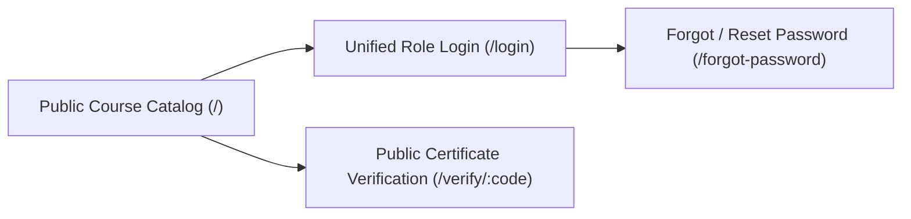

# Public Portal & Certificate Verification Wireframes

**Document Version:** 1.0.0  
**Target Role:** Public Visitor (`PUBLIC`)  
**Design System Palette:** `#4F46E5` (Indigo 600), `#06B6D4` (Cyan 500), `#8B5CF6` (Violet 500), `#F8FAFC` (Slate 50)

---

## 1. Public Journey Architecture



---

## 2. Screen 1: Public Certificate Verification Portal (`/verify/:code`)

```
+--------------------------------------------------------------------------------------------------+
| [LMS LOGO #4F46E5]   Enterprise LMS Credential Registry             [Browse Courses] [Sign In ->]|
+--------------------------------------------------------------------------------------------------+
|                                                                                                  |
|                         INSTITUTIONAL CREDENTIAL VERIFICATION PORTAL                             |
|              Verify the authenticity of any Enterprise LMS certificate in real time.             |
|                                                                                                  |
|                    +---------------------------------------------+ +------------------+          |
|                    | CERT-2026-FSWD-00042                        | | Verify Credential|          |
|                    +---------------------------------------------+ +------------------+          |
|                                                                                                  |
|           +--------------------------------------------------------------------------+           |
|           | [VERIFIED AUTHENTIC CREDENTIAL — ISSUED & ACTIVE]              (#10B981) |           |
|           |--------------------------------------------------------------------------|           |
|           | Certificate Code   : CERT-2026-FSWD-00042                                |           |
|           | Verification UUID  : 8f9d2a1c-4b7e-4e1a-9c3d-123456789abc                |           |
|           | Recipient Name     : Aarav Mehta                                         |           |
|           | Course Completed   : Full-Stack Web Development (React 19 & FastAPI)     |           |
|           | Batch Cohort       : FSWD-2026A                                          |           |
|           | Completion Score   : 91.4% (Grade: A+ with Distinction)                  |           |
|           | Attendance Record  : 92.5% Verified Attendance                           |           |
|           | Issue Date         : November 25, 2026                                   |           |
|           | Issuing Authority  : Enterprise LMS Academic Board                       |           |
|           +--------------------------------------------------------------------------+           |
|                                                                                                  |
+--------------------------------------------------------------------------------------------------+
```

---

## 3. Screen 2: Unified Role Authentication Screen (`/login`)

```
+--------------------------------------------------------------------------------------------------+
| +----------------------------------------------+ +---------------------------------------------+ |
| | BRAND SHOWCASE PANEL (#4F46E5 -> #8B5CF6)    | | SIGN IN TO ENTERPRISE LMS                   | |
| |                                              | |                                             | |
| |   Enterprise Learning Management System      | | Email Address *                             | |
| |                                              | | [ admin@lms.edu                           ] | |
| |   • 22 Integrated Academic & Finance Modules | |                                             | |
| |   • Real-time Attendance & Progress Engines  | | Password *                                  | |
| |   • Timed Quizzes with Anti-Cheat Telemetry  | | [ •••••••••••••••                     (o) ] | |
| |   • Instant Verifiable Digital Certificates  | |                                             | |
| |                                              | | [x] Remember session   [Forgot Password?]   | |
| |   Quick Demo Credentials Switcher:           | |                                             | |
| |   [Admin Demo] [Instructor Demo] [Student]   | | [       Sign In to Portal (#4F46E5)       ] | |
| |                                              | |                                             | |
| |   Need to verify a certificate?              | | Protected by JWT Rotation & RBAC Security   | |
| |   [Open Public Credential Verifier ->]       | |                                             | |
| +----------------------------------------------+ +---------------------------------------------+ |
+--------------------------------------------------------------------------------------------------+
```

---

## 4. Component Breakdown

| Component Name | Responsibility | Visual Highlights |
| :--- | :--- | :--- |
| `CredentialVerifierCard` | Queries `GET /api/v1/certificates/verify/{code}` and renders tamper-evident status badge | Emerald badge for `ISSUED`, Rose alert banner for `REVOKED` or `NOT_FOUND` |
| `UnifiedLoginForm` | Handles authentication, stores Access Token in memory/state and Refresh Token securely, routes user by role (`/admin`, `/instructor`, `/student`) | Indigo `#4F46E5` primary CTA button with loading spinner |
| `DemoRoleQuickFill` | One-click credential prefill buttons for evaluators testing Admin, Instructor, and Student personas | Subtle Violet `#8B5CF6` & Cyan `#06B6D4` outline chips |
