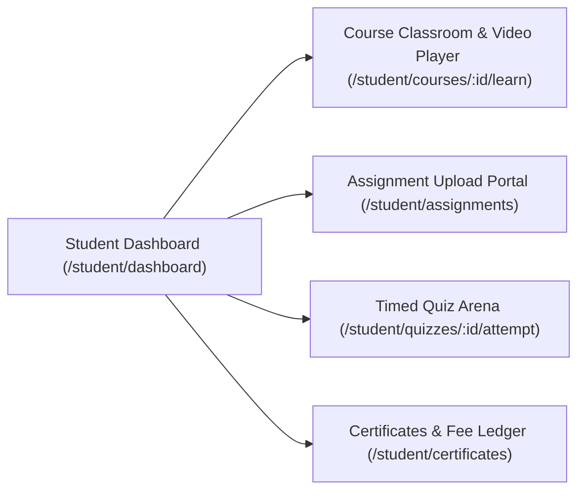

# Student Learning Portal UI/UX Wireframes & Component Hierarchy

**Document Version:** 1.0.0  
**Target Role:** Student (`STUDENT`)  
**Design System Palette:** `#4F46E5` (Primary Indigo), `#06B6D4` (Secondary Cyan), `#8B5CF6` (Accent Violet), `#F8FAFC` (Background Slate 50)

---

## 1. Student Learning Journey Flow



---

## 2. Screen 1: Student Learning Dashboard (`/student/dashboard`)

```
+--------------------------------------------------------------------------------------------------+
| [LMS] Student Portal           Batch: FSWD-2026A                [Bell(2)] [Aarav Mehta (STU-1001)]|
+----------------------+---------------------------------------------------------------------------+
| NAVIGATION           | MY LEARNING PROGRESS & OVERVIEW                                           |
|                      |                                                                           |
| (*) Dashboard        | +-----------------------+ +-----------------------+ +--------------------+|
| ( ) My Classroom     | | COURSE COMPLETION     | | ATTENDANCE HEALTH     | | FEE & ELIGIBILITY  ||
| ( ) Assignments (1)  | | 84.0% [██████████░░]  | | 92.5% (37/40 Classes) | | Pending: $0.00     ||
| ( ) Quizzes          | | 50%L + 30%A + 20%Q    | | Threshold: >= 75% OK  | | Cert Status: READY ||
| ( ) My Attendance    | +-----------------------+ +-----------------------+ +--------------------+|
| ( ) Fee & Receipts   |                                                                           |
| ( ) My Certificates  | +-----------------------------------------------+ +----------------------+|
| ( ) Announcements    | | CONTINUE LEARNING                             | | UPCOMING DEADLINES   ||
|                      | | [ > ] Lecture 2.2: JWT Refresh Rotation       | | [!] Assignment #4    ||
|                      | |       Module 2 • Resume at 18:40 / 45:00      | |     Due in 2 days    ||
|                      | |       [Resume Lecture (#4F46E5)]              | | [?] Module 2 Quiz    ||
|                      | +-----------------------------------------------+ |     45 Mins • 30 Pts ||
|                      |                                                   +----------------------+|
+----------------------+---------------------------------------------------------------------------+
```

---

## 3. Screen 2: Interactive Classroom & Lecture Player (`/student/courses/:id/learn`)

```
+--------------------------------------------------------------------------------------------------+
| <- Back to Dashboard | Full-Stack Web Development (FSWD-2026A)         Overall Progress: [84.0%] |
+------------------------------------------------------------------+-------------------------------+
| VIDEO / CONTENT STAGE (#0F172A)                                  | COURSE SYLLABUS & PROGRESS    |
| +--------------------------------------------------------------+ |                               |
| |                                                              | | MODULE 1: React 19 (2/2)      |
| |                     [  |>  PLAY LECTURE  ]                   | |  [x] 1.1 React Compiler (24m) |
| |                                                              | |  [x] 1.2 Suspense (38m)       |
| |  00:18:42 [========================●---------------] 00:45:00| |                               |
| +--------------------------------------------------------------+ | MODULE 2: FastAPI (1/2)       |
|                                                                  |  [x] 2.1 Pydantic v2 (31m)    |
| Lecture 2.2: JWT Auth & Refresh Token Rotation                   |  [>] 2.2 JWT Auth (Playing)   |
| [x] Completed  |  [Download Slides.pdf]  [Download Starter.zip]  |                               |
|------------------------------------------------------------------| MODULE 3: MySQL 8 (0/2)       |
| Tabs: [Lecture Notes] [Attached Materials (2)] [Related Quiz]    |  [ ] 3.1 Indexing & FKs (40m) |
+------------------------------------------------------------------+-------------------------------+
```

---

## 4. Screen 3: Timed Quiz Arena with Anti-Cheat Banner (`/student/quizzes/:id/attempt`)

```
+--------------------------------------------------------------------------------------------------+
| [QUIZ IN PROGRESS] Module 2 Assessment: FastAPI Security     Server Timer: [ 00 : 28 : 14 ] (#F43)|
| [!] Anti-Cheat Active: Do not switch tabs or exit fullscreen. Warnings used: 0 / 3               |
+------------------------------------------------------------------+-------------------------------+
| QUESTION 14 OF 20 (Single Choice • 2 Marks)                      | QUESTION PALETTE              |
|                                                                  |                               |
| Which database strategy prevents a stolen Refresh Token from     | [01] [02] [03] [04] [05]      |
| being reused indefinitely after a user logs out?                 | [06] [07] [08] [09] [10]      |
|                                                                  | [11] [12] [13] (14) [15]      |
| ( ) A. Storing the JWT secret inside localStorage                | [16] [17] [18] [19] [20]      |
| (•) B. Persisting token JTI/hash in MySQL refresh_tokens with    |                               |
|        revocation and single-use rotation                        | Legend:                       |
| ( ) C. Increasing Access Token TTL to 30 days                    | [##] Answered (13)            |
| ( ) D. Disabling signature verification on /auth/refresh         | (14) Current                  |
|                                                                  | [  ] Unanswered (6)           |
| [<- Previous]                          [Save & Next Question ->] |                               |
|                                                                  | [Submit Final Quiz (#4F46E5)] |
+------------------------------------------------------------------+-------------------------------+
```

---

## 5. Component Breakdown

| Component Name | Responsibility | Visual Highlights |
| :--- | :--- | :--- |
| `WeightedProgressGauge` | Displays breakdown of `50% Lectures + 30% Assignments + 20% Quizzes` | Multi-segment ring chart using `#4F46E5`, `#06B6D4`, `#8B5CF6` |
| `LectureVideoPlayer` | Streams video and dispatches 15-second heartbeat progress pings | Dark cinema frame `#0F172A` with auto-complete toggle |
| `ServerSyncedQuizTimer` | Calculates remaining seconds from server `expires_at` timestamp | Pulses rose `#F43F5E` when `< 300 seconds` remain |
| `CertificateCard` | Displays earned certificate preview, verification QR, and PDF download | Gradient border `from-indigo-600 via-violet-500 to-cyan-500` |
