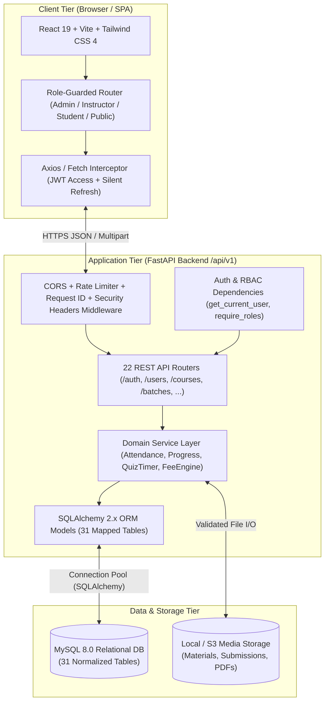
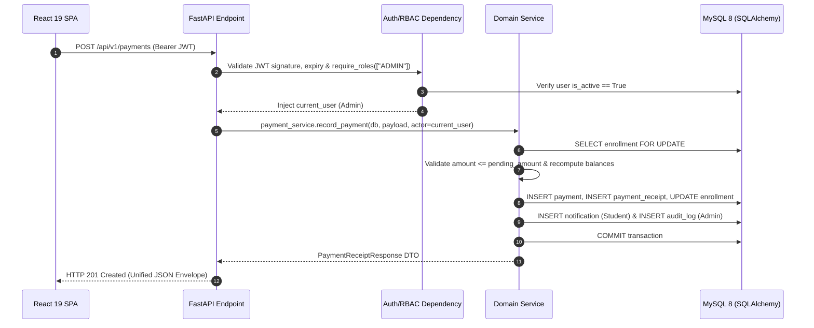

# System Architecture & Technical Design — Enterprise LMS

**Document Version:** 1.0.0  
**Frontend Stack:** React 19 + Vite 6 + Tailwind CSS 4 + React Router 7 + Lucide Icons  
**Backend Stack:** Python 3.12 + FastAPI + SQLAlchemy 2.x + Pydantic v2 + PyMySQL / MySQL 8  

---

## 1. High-Level Architecture Diagram



---

## 2. Repository Directory Structure

```text
d:\LLM-VibeCoding\
├── backend/
│   ├── app/
│   │   ├── api/
│   │   │   ├── deps.py                 # JWT decoding, RBAC & resource ownership guards
│   │   │   └── v1/
│   │   │       ├── api.py              # Central v1 APIRouter aggregator
│   │   │       └── endpoints/          # 22 modular route handlers
│   │   │           ├── auth.py
│   │   │           ├── users.py
│   │   │           ├── students.py
│   │   │           ├── instructors.py
│   │   │           ├── categories.py
│   │   │           ├── courses.py
│   │   │           ├── batches.py
│   │   │           ├── enrollments.py
│   │   │           ├── lectures.py
│   │   │           ├── materials.py
│   │   │           ├── progress.py
│   │   │           ├── assignments.py
│   │   │           ├── submissions.py
│   │   │           ├── quizzes.py
│   │   │           ├── attendance.py
│   │   │           ├── certificates.py
│   │   │           ├── payments.py
│   │   │           ├── notifications.py
│   │   │           ├── announcements.py
│   │   │           ├── reports.py
│   │   │           ├── settings.py
│   │   │           └── health.py
│   │   ├── core/
│   │   │   ├── config.py               # Pydantic BaseSettings (.env loader)
│   │   │   ├── database.py             # SQLAlchemy 2.x engine & SessionLocal
│   │   │   ├── security.py             # Argon2/bcrypt & JWT token utilities
│   │   │   └── exceptions.py           # Unified JSON error handlers
│   │   ├── models/                     # 31 SQLAlchemy 2.x ORM models
│   │   ├── schemas/                    # Pydantic v2 request/response DTOs
│   │   ├── services/                   # Business rule engines (attendance, fees, certs)
│   │   ├── utils/                      # File storage, PDF generator, pagination
│   │   └── main.py                     # FastAPI application entrypoint
│   ├── scripts/
│   │   └── seed_db.py                  # Idempotent demo data seeder
│   ├── tests/                          # Pytest unit & integration suites
│   ├── requirements.txt
│   └── .env.example
├── frontend/
│   ├── src/
│   │   ├── api/                        # Typed API client & token refresh interceptor
│   │   ├── components/                 # Reusable UI widgets, modals, tables, charts
│   │   ├── context/                    # AuthContext & Toast/Notification provider
│   │   ├── layouts/                    # Role-specific AppShells (Admin, Instructor, Student)
│   │   ├── pages/
│   │   │   ├── admin/                  # Admin management consoles
│   │   │   ├── instructor/             # Curriculum, attendance, grading studios
│   │   │   ├── student/                # Classroom player, quiz arena, certificates
│   │   │   └── public/                 # Login, catalog, public certificate verifier
│   │   ├── types/                      # TypeScript domain interfaces
│   │   ├── App.tsx
│   │   └── main.tsx
│   ├── index.html
│   ├── package.json
│   └── vite.config.ts
└── docs/                               # Complete engineering & user documentation
```

---

## 3. Request Lifecycle & Service Layer Pattern



### Why the Service Layer Pattern?
1. **Thin Controllers:** FastAPI route functions handle only HTTP parsing, status codes, and dependency injection.
2. **Transactional Integrity:** Multi-table mutations (e.g., recording a payment + updating enrollment balance + generating a receipt + writing an audit log) execute inside a single atomic DB session commit.
3. **Reusable Business Rules:** Course completion and attendance formulas live in dedicated services invoked consistently by lecture progress, grading, quiz submission, and certificate eligibility checks.

---

## 4. Storage Strategy (Media, Submissions & Generated PDFs)

- **Local Development & Single-Node Deployment:** Files are stored in a structured, non-executable directory outside the source code tree:
  - `uploads/materials/{course_id}/{uuid}_{filename}`
  - `uploads/submissions/{assignment_id}/{student_id}/{uuid}_{filename}`
  - `uploads/certificates/{certificate_code}.pdf`
  - `uploads/receipts/{receipt_number}.pdf`
- **Cloud Production Deployment:** Abstracted behind a storage service interface (`StorageProvider`) allowing zero-code-change switching between local disk volumes and S3-compatible object storage (AWS S3, Cloudflare R2, MinIO) via `STORAGE_BACKEND=local|s3`.
