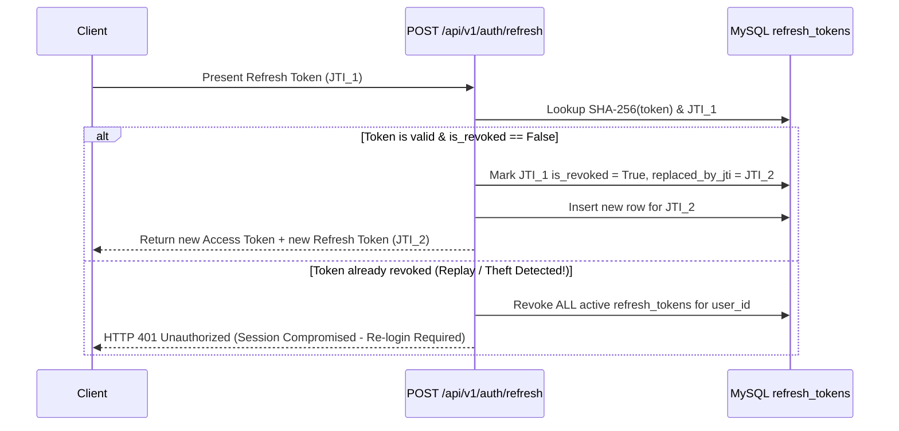

# Security Architecture & Compliance Specification

**Document Version:** 1.0.0  
**Project:** Enterprise LMS  

---

## 1. Authentication & JWT Token Lifecycle

### 1.1 Dual-Token Architecture
The Enterprise LMS uses a hybrid **Stateless Access Token + Stateful Rotating Refresh Token** design:

| Token Type | Lifetime (TTL) | Storage (Server) | Claims Included | Purpose |
| :--- | :--- | :--- | :--- | :--- |
| **Access Token** | `30 minutes` (`ACCESS_TOKEN_EXPIRE_MINUTES=30`) | Stateless (Verified via HMAC-SHA256 `SECRET_KEY`) | `sub` (user_id), `role` (`ADMIN`/`INSTRUCTOR`/`STUDENT`), `email`, `type="access"`, `exp`, `iat` | Authorizing `/api/v1/*` calls via `Authorization: Bearer <token>` |
| **Refresh Token** | `7 days` (`REFRESH_TOKEN_EXPIRE_DAYS=7`) | SHA-256 hash stored in `refresh_tokens` table with `jti`, `is_revoked`, `replaced_by_jti` | `sub` (user_id), `jti` (UUIDv4), `type="refresh"`, `exp`, `iat` | Obtaining a fresh Access/Refresh token pair at `POST /api/v1/auth/refresh` |

### 1.2 Refresh Token Rotation & Reuse Detection

---

## 2. Password Hashing & Credential Hygiene

- **Hashing Algorithm:** Passwords are hashed using **bcrypt** (cost factor `12`) / **Argon2id** via `passlib` / `bcrypt`.
- **Password Policy Enforcement:** Minimum 8 characters, requiring at least one uppercase letter, one lowercase letter, one digit, and one special character.
- **Password Reset Security:**
  - `POST /api/v1/auth/forgot-password` generates a cryptographically random 32-byte URL-safe token (`secrets.token_urlsafe(32)`).
  - Only the **SHA-256 hash** of the reset token is persisted in `password_reset_tokens` with a strict 30-minute expiry and `is_used = False`.
  - Upon successful password reset, `is_used` is set to `True` and all active `refresh_tokens` for that user are revoked.

---

## 3. Role-Based Access Control (RBAC) & Resource-Level Ownership

Authorization is enforced in two layers on every protected endpoint:

### Layer 1: Role Guard Dependency (`require_roles`)
FastAPI dependency factory verifying that `current_user.role.name` is in the permitted list (e.g., `Depends(require_roles("ADMIN", "INSTRUCTOR"))`). Unauthorized roles receive an immediate `403 Forbidden`.

### Layer 2: Resource Ownership & Scope Verification
Even when a user holds a valid role, data access is strictly scoped:
- **Instructor Scope Check:** An `INSTRUCTOR` can only create lectures, mark attendance, or grade submissions for a `batch_id` or `course_id` where `batch.instructor_id == current_user.id` (or course ownership matches). Attempting to modify another instructor's batch raises `403 Forbidden`.
- **Student Ownership Check:** A `STUDENT` can only stream lectures, download materials, submit assignments, or view fee receipts for enrollments where `enrollment.student_id == current_user.id`.

---

## 4. File Upload Validation & Sandboxing

All file uploads (`study_materials`, `submissions`, user avatars) pass a 4-stage security filter before touching disk:
1. **Extension Allowlist:** Only explicitly approved extensions are accepted (`.pdf`, `.pptx`, `.docx`, `.zip`, `.png`, `.jpg`, `.jpeg`, `.txt`, `.py`, `.md`). Executable extensions (`.exe`, `.bat`, `.cmd`, `.sh`, `.php`, `.dll`, `.js`, `.html`) are blocked.
2. **Magic-Byte / MIME Inspection:** Content headers are validated against expected file signatures.
3. **Size Quota Enforcement:** Maximum `50 MB` for study materials, `25 MB` for student assignment submissions, and `5 MB` for profile avatars.
4. **Path Traversal Sanitization:** User-supplied filenames are stripped of directory segments (`os.path.basename`) and prefixed with a server-generated UUIDv4 (`{uuid4}_{safe_name}`).

---

## 5. SQL Injection, XSS & CSRF Defenses

- **SQL Injection Prevention:** 100% of database queries use **SQLAlchemy 2.x parameterized bound statements**. Raw string interpolation in SQL is strictly prohibited.
- **XSS Prevention:** React 19 automatically escapes dynamic expressions in JSX; Pydantic v2 sanitizes and validates string lengths and formats on input.
- **CORS & Security Headers:**
  - `CORSMiddleware` restricts origins to explicit frontend hosts (`ALLOWED_ORIGINS`).
  - Response headers include `X-Content-Type-Options: nosniff`, `X-Frame-Options: DENY`, and `Referrer-Policy: strict-origin-when-cross-origin`.
- **Rate Limiting:** Sensitive authentication endpoints (`/auth/login`, `/auth/forgot-password`, `/certificates/verify/*`) enforce IP/identifier throttling to mitigate credential stuffing and enumeration attacks.

---

## 6. Immutable Audit Logging

Every critical administrative and academic mutation writes a structured entry to `audit_logs`:
- **Logged Events:** `USER_CREATED`, `USER_ROLE_UPDATED`, `USER_DEACTIVATED`, `ENROLLMENT_CREATED`, `PAYMENT_RECORDED`, `SUBMISSION_GRADED`, `QUIZ_TERMINATED_ANTICHEAT`, `CERTIFICATE_ISSUED`, `CERTIFICATE_REVOKED`, `SETTINGS_UPDATED`.
- **Captured Payload:** `actor_id`, `action`, `entity_type`, `entity_id`, JSON `old_values`, JSON `new_values`, client `ip_address`, and UTC `created_at`.
