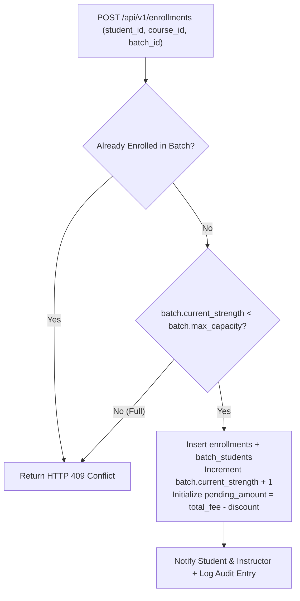

# Module Specification: Batches, Cohorts & Enrollments (`batches.md`)

**Module Route Prefix:** `/api/v1/batches`, `/api/v1/enrollments`  
**Database Tables:** `batches`, `batch_students`, `enrollments`  

---

## 1. Module Responsibilities
1. Schedule time-bound operational cohorts (`batches`) for a course with an assigned primary `instructor_id`.
2. Enforce seat capacity limits (`current_strength <= max_capacity`) using transactional row locking.
3. Manage student enrollment contracts (`enrollments` & `batch_students`), initializing fee ledgers and academic progress trackers.

---

## 2. Capacity & Enrollment Workflow

---

## 3. Lifecycle Transitions
- **Batch Statuses:** `UPCOMING` -> `ONGOING` -> `COMPLETED` (or `CANCELLED`).
- **Enrollment Statuses:**
  - `ACTIVE`: Student has full access to batch lectures, assignments, quizzes, and attendance.
  - `DROPPED`: Releases 1 seat from `batches.current_strength` and halts attendance tracking from the drop date.
  - `COMPLETED`: Set automatically or by Admin once completion criteria are satisfied.
