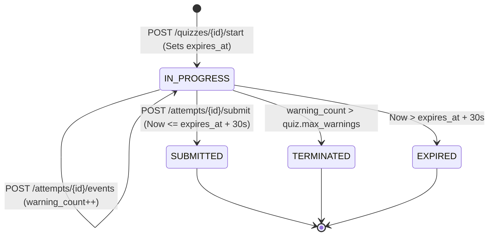

# Module Specification: Timed Quizzes & Anti-Cheat Engine (`quizzes.md`)

**Module Route Prefix:** `/api/v1/quizzes`  
**Database Tables:** `quizzes`, `questions`, `quiz_options`, `quiz_attempts`, `quiz_answers`, `quiz_attempt_events`  

---

## 1. Module Responsibilities
1. Author timed objective and short-answer assessments (`quizzes`, `questions`, `quiz_options`).
2. Enforce authoritative server-side quiz attempt timers (`started_at`, `expires_at`).
3. Capture real-time browser focus/proctoring violations (`quiz_attempt_events`) and auto-terminate attempts exceeding `max_warnings`.
4. Auto-grade submissions and feed passing results into the `20%` Quiz component of course completion.

---

## 2. Server-Side Timer & Anti-Cheat State Machine

---

## 3. Security & Integrity Guarantees
- **Answer Leakage Prevention:** When a `STUDENT` requests `GET /api/v1/quizzes/{quiz_id}`, the serializer strips `is_correct` and `explanation` from all `quiz_options` and `questions`. These fields are only exposed after the attempt status reaches `SUBMITTED`.
- **Idempotent Auto-Grading:** Submitting an attempt iterates over all `quiz_answers`, compares `selected_option_id` against `quiz_options.is_correct`, computes `score_obtained` and `percentage`, sets `is_passed = (percentage >= quiz.passing_percentage)`, and triggers course progress recalculation.
